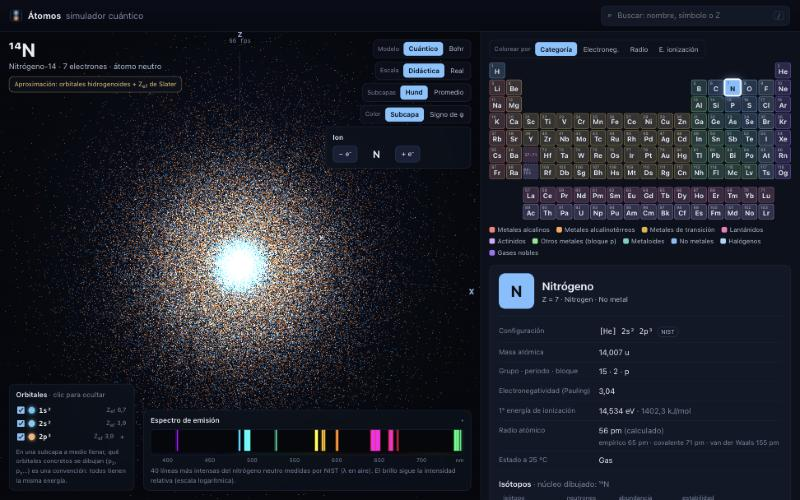
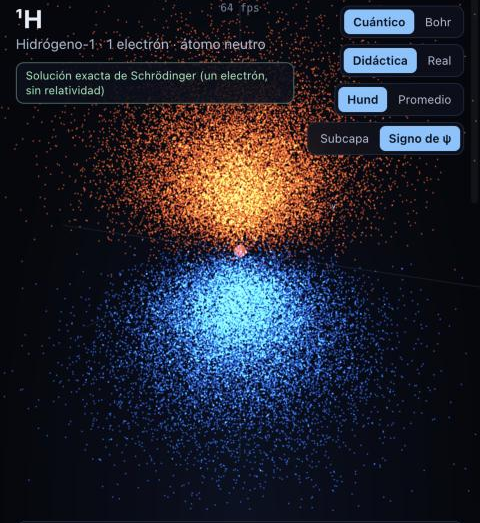
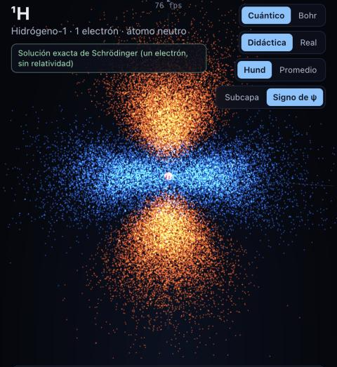
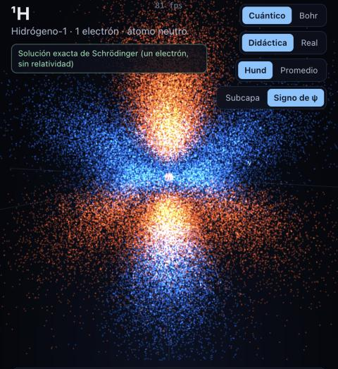

# Átomos · simulador cuántico

Simulador 3D de átomos en el que los electrones **no** giran en círculos: cada orbital
ocupado se dibuja como una nube de puntos muestreada de |ψ|², la densidad de probabilidad
de la mecánica cuántica. Al lado, la tabla periódica completa (118 elementos) con datos
reales de NIST, PubChem y el OIEA.

**▶ Abrirlo en el navegador:** <https://juaneprietoreyes-lang.github.io/atomos/>
(funciona en ordenador, tableta y móvil; no hay que instalar nada)



| 2p<sub>z</sub> | 3d<sub>z²</sub> (con su anillo) | 4f<sub>z³</sub> |
|---|---|---|
|  |  |  |

*Coloreados por el signo de ψ: cálido = positivo, frío = negativo. Hidrógeno excitado, solución exacta.*

## Qué se puede hacer

- **Elegir cualquier elemento** en la tabla (o con el buscador, tecla `/`): el átomo se
  reconstruye con una transición suave. Las capas que comparten dos átomos se encogen o
  crecen según su carga nuclear efectiva.
- **Ver cada orbital**: la leyenda muestra las subcapas (1s, 2s, 2p…) con su color, su
  número de electrones y su Z<sub>ef</sub>; se pueden ocultar y desplegar en orbitales
  concretos (2p<sub>x</sub>, 3d<sub>z²</sub>…). Al aislar uno se dibuja con más puntos.
- **Iones**: quitar o añadir electrones (Na⁺, Cl⁻, Fe²⁺…). La configuración y las cargas
  efectivas se recalculan.
- **Isótopos**: en la ficha se elige el isótopo y el núcleo cambia su número de neutrones.
- **Escala real o didáctica**: en escala real el núcleo es entre 20 000 y 45 000 veces más
  pequeño que el átomo y ocupa milésimas de píxel; la app lo explica con los números de cada isótopo.
- **Excitar el hidrógeno** (y cualquier átomo de un electrón: He⁺, Li²⁺…): absorber un
  fotón, emitir con la probabilidad real de cada salto, cascada automática, serie
  (Lyman, Balmer, Paschen…) y color del fotón o marca UV/IR.
- **Espectro de emisión**: Balmer calculado para el hidrógeno; para el resto, las líneas
  medidas por NIST. Si NIST no tiene datos, no se dibuja nada.
- **Mapa de calor** en la tabla por electronegatividad, radio o energía de ionización.
- **Modo Bohr**, claramente marcado como modelo histórico simplificado.

## Cómo funciona la física

| Pieza | Qué se hace | Dónde |
|---|---|---|
| Parte radial | Funciones hidrogenoides normalizadas con polinomios de Laguerre asociados | [`radial.ts`](src/physics/radial.ts) |
| Parte angular | Armónicos esféricos **reales** (dan las formas de s, p, d, f de los libros) | [`harmonics.ts`](src/physics/harmonics.ts) |
| Varios electrones | Carga nuclear efectiva con las reglas de Slater (Na 3s → Z<sub>ef</sub> = 2,20) | [`slater.ts`](src/physics/slater.ts) |
| Tamaño de las capas | Forma hidrogenoide escalada para que ⟨r⟩ sea el de un orbital de Slater con su n* | [`orbitals.ts`](src/physics/orbitals.ts) |
| Muestreo | Monte Carlo: r por transformada inversa de r²R², dirección por *rejection sampling* de Y². Exacto (sin la autocorrelación de Metropolis), con semilla | [`sampling.ts`](src/physics/sampling.ts) |
| Configuraciones | Las de NIST, con sus excepciones reales; Madelung solo para detectarlas y para los aniones | [`configuration.ts`](src/physics/configuration.ts) |
| Hidrógeno | Rydberg con masa reducida, vacío→aire (Peck y Reeder), coeficientes de Einstein A por integrales dipolares | [`hydrogen.ts`](src/physics/hydrogen.ts) |
| Núcleo | R = 1,2 fm·A<sup>1/3</sup>; esferas empaquetadas por relajación | [`nucleus.ts`](src/physics/nucleus.ts) |
| Color de la luz | Funciones CIE 1931 (ajuste de Wyman et al., 2013) → sRGB | [`wavelength-color.ts`](src/physics/wavelength-color.ts) |

Un detalle que hace que todo vaya rápido: R<sub>nl</sub> solo depende de Z·r, así que la nube
de un orbital (n, l, m) es la misma para cualquier átomo y Z<sub>ef</sub> solo la escala. Se
muestrea una vez por orbital en un Web Worker, se guarda en caché y se reutiliza para los
118 elementos. Todo se dibuja con `THREE.Points` (una llamada por orbital): unos 220 000
puntos para los átomos pesados, que en el Mac de desarrollo van sobrados a 60 fps (unos 0,3 ms por fotograma); si un equipo no llega a 45 fps, la app dibuja menos puntos.

## Datos: nada inventado

- Fuentes, licencias y fecha de descarga: [`data/raw/FUENTES.md`](data/raw/FUENTES.md).
- Cómo se resolvió cada discrepancia entre fuentes: [`data/INFORME.md`](data/INFORME.md).
- Las configuraciones electrónicas vienen de NIST, con sus excepciones reales a la regla
  de Madelung (Cr, Cu, Nb, Mo, Ru, Rh, Pd, Ag, Pt, Au, La, Ce, Gd, Ac, Th, Pa, U, Np, Cm, Lr).
  La ficha avisa cuando un elemento es una excepción y muestra lo que predeciría Madelung.
- Lo que no se conoce aparece como «desconocido»; lo calculado o extrapolado, como
  «predicho», «calculada» o «semiempírica», según lo marque la fuente.

## Limitaciones del modelo

Esto es lo que el simulador **no** hace bien, a propósito o por no existir solución exacta:

1. **Átomos de varios electrones.** Solo el átomo de un electrón (H, He⁺, Li²⁺…) tiene
   solución exacta de la ecuación de Schrödinger, y la app lo indica. Para el resto, cada
   electrón ocupa un orbital hidrogenoide con una carga nuclear efectiva de Slater: un
   modelo de electrones independientes, sin correlación electrónica. Las reglas de Slater
   (1930) son empíricas y aproximadas.
2. **Tamaño de las capas.** Con n entero, el hidrogenoide exagera las capas externas (el 6s
   del Cs saldría con ⟨r⟩ ≈ 24 a₀). Se conserva la forma hidrogenoide, con sus nodos, y se
   escala para que ⟨r⟩ coincida con el de un orbital de Slater de n efectivo n*. Para n = 7
   Slater no dio n*: se usa 4,3, una extrapolación. Las posiciones de los nodos radiales de
   los átomos pesados son, por tanto, aproximadas.
3. **Sin relatividad.** En los átomos pesados (Au, Hg, superpesados) los electrones
   internos van tan rápido que las capas s y p se contraen; aquí no aparece (por eso el
   modelo no explica, por ejemplo, el color del oro). Tampoco hay estructura fina,
   interacción espín-órbita ni desplazamiento de Lamb: el Hα calculado difiere unos
   0,01 nm del medido.
4. **Subcapas a medio llenar.** Qué orbitales concretos se dibujan (p<sub>z</sub> antes que
   p<sub>x</sub>…) es una convención, porque tienen la misma energía. El estado real de un
   átomo libre es una combinación de esas posibilidades. El interruptor «Promedio» reparte
   los electrones por igual y da la nube esférica.
5. **Iones.** Se quitan los electrones de mayor n (y a igual n, de mayor l) y se añaden
   siguiendo Madelung. Es la regla habitual; hay excepciones que no se reproducen. Las
   propiedades de la ficha (radio, energía de ionización…) son del átomo neutro.
6. **Núcleo.** Esferas rígidas empaquetadas con protones y neutrones colocados al azar. El
   núcleo real es un sistema cuántico sin bordes nítidos (modelo de capas nuclear).
7. **Brillo.** Cada punto pesa lo mismo y el brillo sigue la densidad de puntos. Hay una
   «exposición» automática única para todo el átomo según el zoom y el número de puntos;
   el núcleo blanco de los átomos pesados es saturación real: ahí la densidad es enorme.
8. **Excitación.** Solo para átomos de un electrón y transiciones dipolares eléctricas
   (Δl = ±1). Se dibuja la componente m = 0 (luz polarizada en z); las probabilidades de
   salto están sumadas a todos los m finales. La animación va unos mil millones de veces
   más lenta que la realidad. La emisión de dos fotones del 2s se muestra sin calcular su
   espectro continuo. El fotón animado no tiene su longitud de onda a escala.
9. **Espectros.** Líneas de NIST del átomo neutro en el visible (las 40 más intensas). Las
   intensidades relativas dependen de la fuente de luz con que se midieron.
10. **Modelo de Bohr.** Es histórico y está mal: los electrones no tienen órbitas
    definidas. Para átomos de varios electrones las órbitas se dibujan sin escala.
11. **Superpesados.** Para Z ≥ 104 las configuraciones son cálculos teóricos; varios
    estados, categorías y semividas son predicciones o datos de isótopos poco confirmados.
12. **Colores de la luz.** La conversión de λ a color es una aproximación: los colores
    espectrales puros no caben en una pantalla sRGB y se desaturan un poco.

## Verificación

- `npm test`: 84 tests (Vitest) de física y datos: normalización de R<sub>nl</sub> (n ≤ 7)
  y de Y<sub>lm</sub> (l ≤ 3), ortogonalidad, posición exacta de los nodos, Slater (Na 3s,
  K 4s, C 2p, Fe 3d/4s, Zn 3d/4s), Hα ≈ 656,47 nm en vacío y 656,28 nm en aire, Hβ, Lyman-α,
  límite de Balmer, desplazamiento isotópico del deuterio, A(2p→1s) = 6,265·10⁸ s⁻¹ (NIST),
  muestreo (⟨r⟩, el hueco del 2s, el anillo del d<sub>z²</sub> con el 38,5 %), configuraciones
  de Cr, Cu, Pd, Au y demás excepciones, iones (Fe²⁺, Ce³⁺, Cl⁻, O²⁻) y el dataset completo.
- Recorrido automático de los 118 elementos en el navegador (neutro, catión, anión, Bohr,
  promedio esférico y escala real): sin errores.
- Comprobación visual de 2p, 3d<sub>z²</sub> y 4f (capturas de arriba).

## Ejecutarlo en local

```bash
npm install
npm run dev
```

| Orden | Para qué |
|---|---|
| `npm run dev` | servidor de desarrollo (con contador de fps) |
| `npm test` | tests de física y datos |
| `npm run build` | comprobación de tipos + compilación a `dist/` |
| `npm run data:fetch` | vuelve a descargar las fuentes a `data/raw/` |
| `npm run data:build` | regenera `src/data/*.json` y `data/INFORME.md` |

Estructura: `src/physics` (cálculos puros, sin DOM), `src/data` (datos generados),
`src/render` (Three.js), `src/ui` (interfaz sin framework) y `src/workers` (muestreo).

## Licencia

Código bajo licencia MIT. Los datos conservan la licencia de su fuente
(`elements.json` incluye datos de Periodic-Table-JSON, CC BY-SA 3.0).
